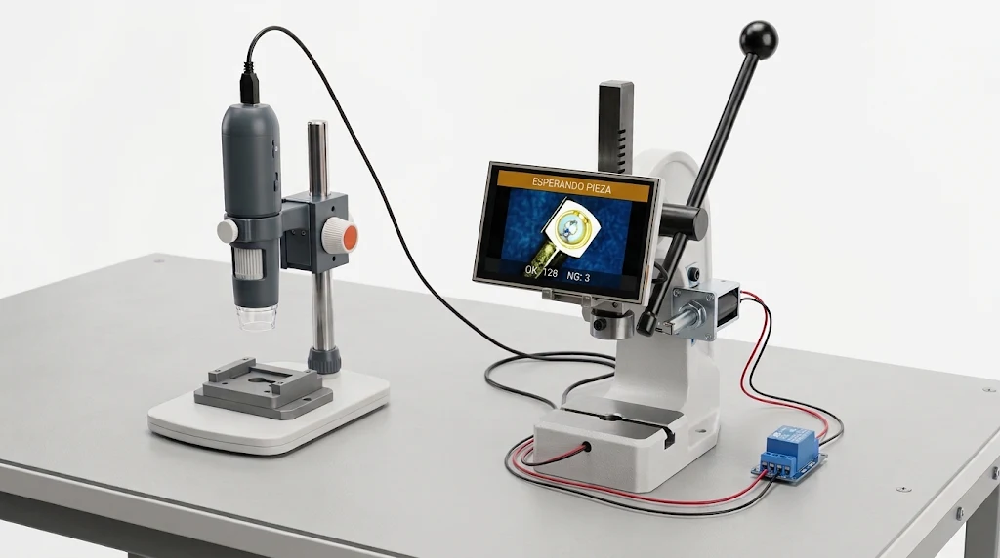
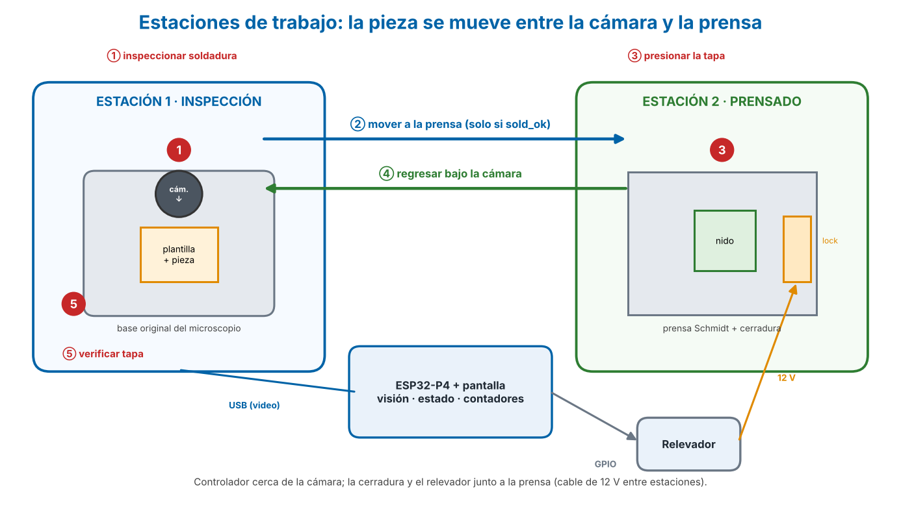

# Inspección con visión – Soldadura y tapa de conector coaxial angular

Sistema autónomo (sin PC en la línea) de control de calidad con visión por computadora. Actúa como **permiso (go)** para una prensa manual: bloquea la palanca hasta detectar soldadura correcta y, después del prensado, verifica que la tapa quedó colocada.

> ⚠️ Es control de calidad, **no** un dispositivo de seguridad certificado.

## Vista previa (ilustración conceptual)

## Documentación
| # | Documento | Contenido |
|---|-----------|-----------|
| 1 | [Propósito y objetivos](docs/01-proposito-objetivos.md) | Qué, por qué, alcance, criterios de éxito |
| 2 | [Diagramas](docs/02-diagramas.md) | Bloques, flujo, estados, eléctrico |
| 3 | [Materiales](docs/03-materiales.md) | Lista de materiales y decisiones de equipo |
| 4 | [Guía de conexiones](docs/04-conexiones.md) | Esquema eléctrico, cableado realista, lista de cables |
| 5 | [Guía de programación](docs/05-guia-programacion.md) | Software, entorno, máquina de estados |
| 6 | [Entrenamiento con imágenes](docs/06-entrenamiento-imagenes.md) | Captura, clases, Edge Impulse |
| 7 | [Seguimiento](docs/07-seguimiento.md) | Pendientes, riesgos, bitácora |
| – | Presentación: [PPTX](docs/presentacion.pptx) · [PDF](docs/presentacion.pdf) · [HTML](docs/presentacion.html) | Deck del proyecto |

## Resumen del ciclo
La cámara está **siempre en su base, apuntando hacia abajo**; la pieza se mueve entre dos estaciones.
1. Colocar el conector (contacto bifurcado) bajo la cámara. 2. Detectar soldadura. 3. Si es OK, desbloquear la prensa por un tiempo límite. 4. Mover la pieza a la prensa y presionar la tapa. 5. Regresar la pieza bajo la cámara. 6. Verificar la tapa. Si falta soldadura o tapa: **rojo y bloqueo**.

## Estado
Fase: preparación / captura de fotos de entrenamiento. Placa P4 en espera de llegada. Ver [seguimiento](docs/07-seguimiento.md).
