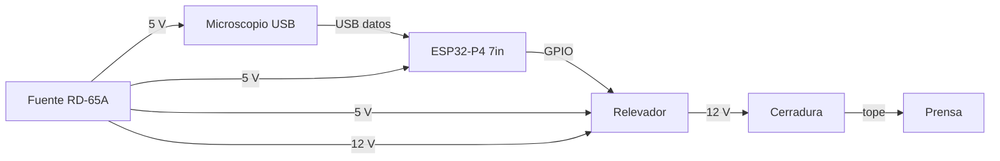
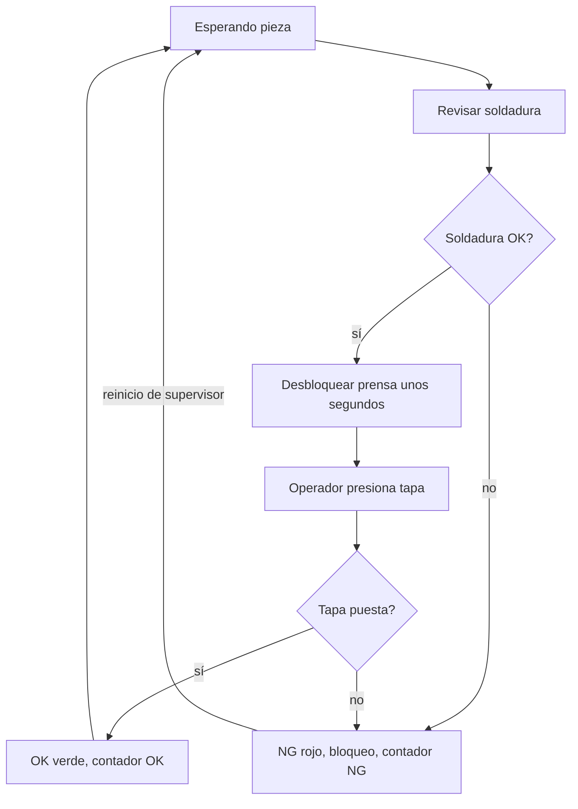
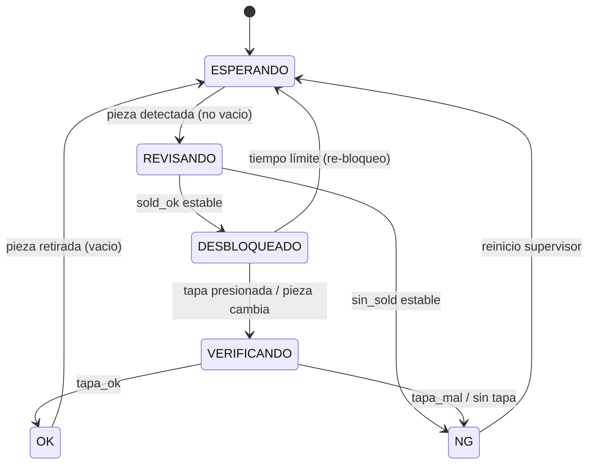
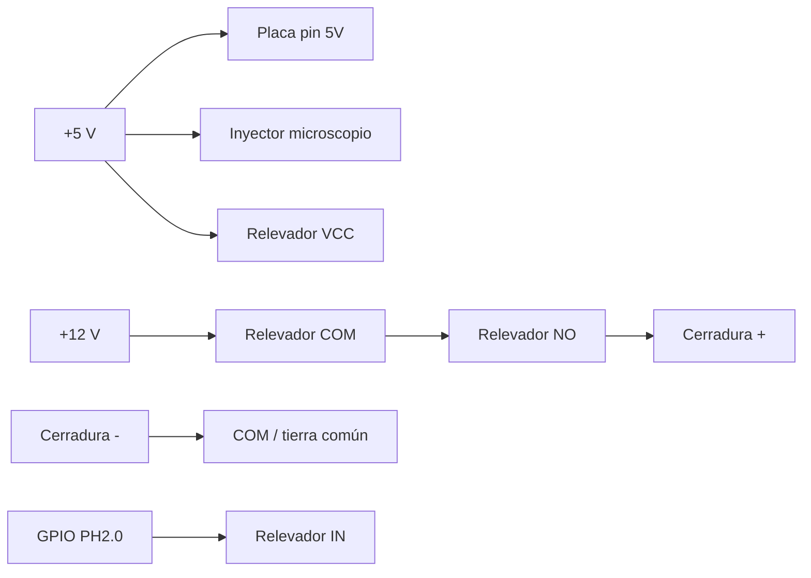

# 2. Diagramas

## Bloques

## Flujo del ciclo

Reglas: tiempo límite (si no se presiona, se vuelve a bloquear); reinicio obligatorio después de NG; la clase `vacio` controla la espera de pieza.

## Estados del firmware

## Eléctrico (resumen)

