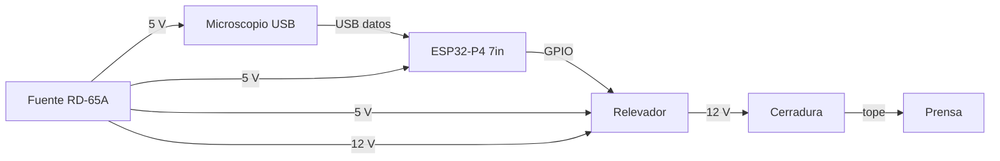
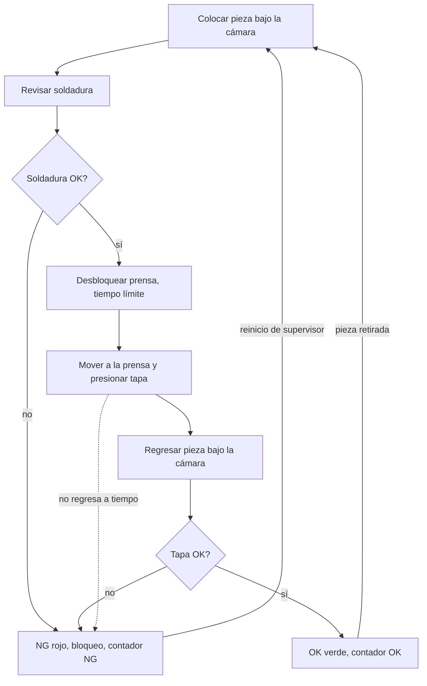
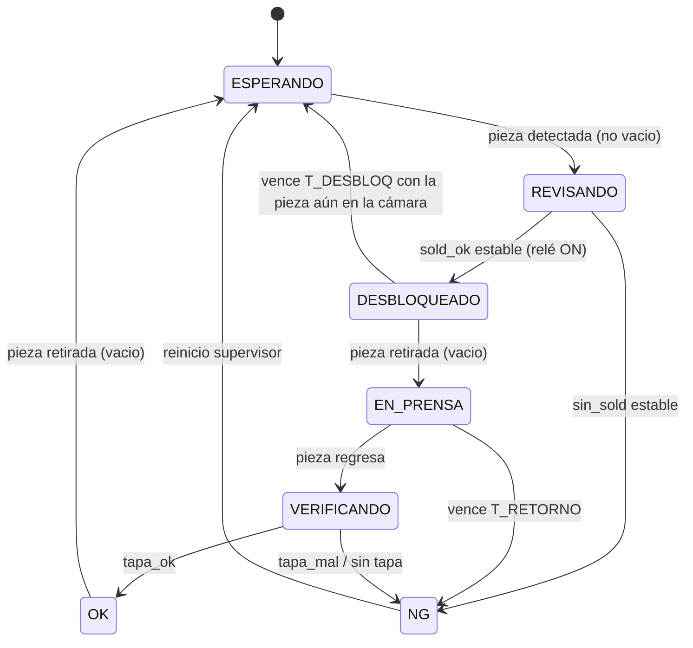
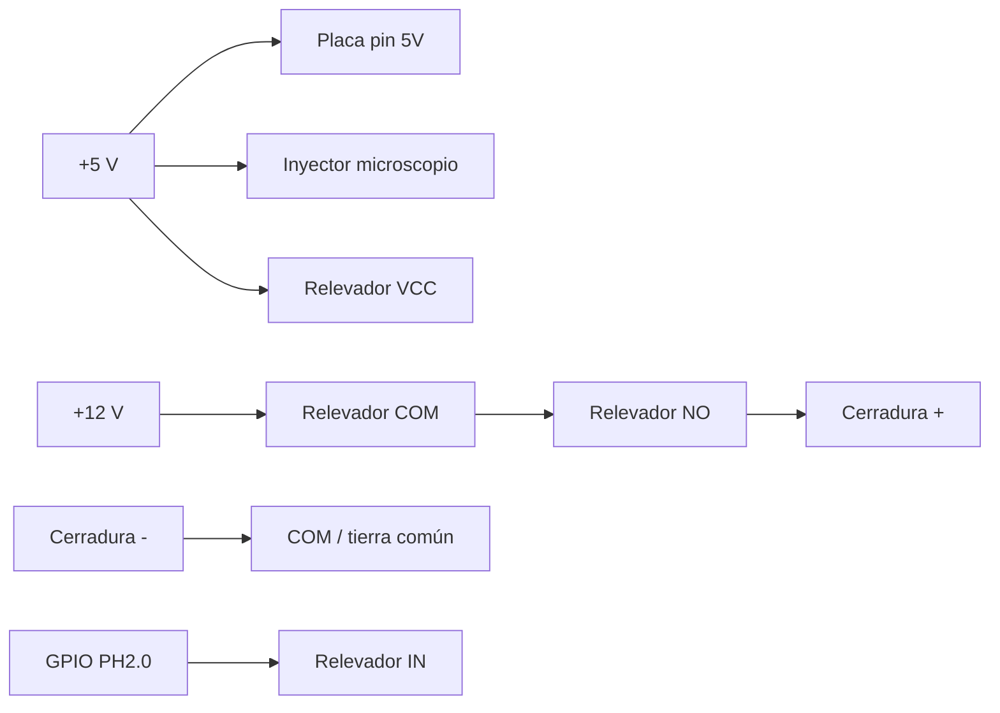
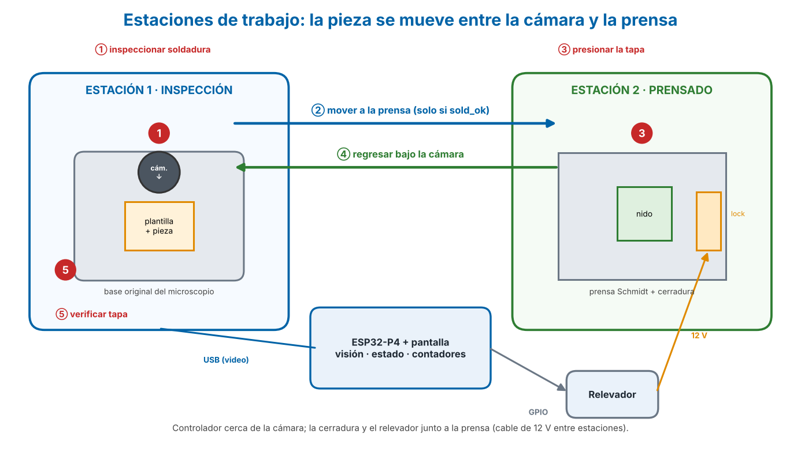
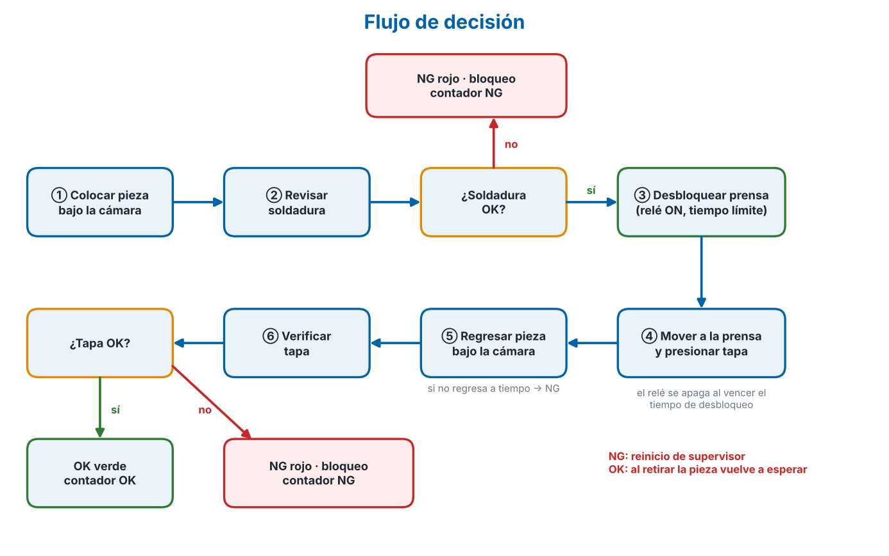
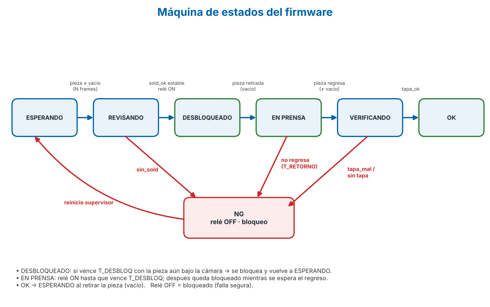

# 2. Diagramas

## Bloques

## Flujo del ciclo

Reglas: tiempo límite de desbloqueo; plazo de retorno de la pieza; reinicio obligatorio después de NG; la clase `vacio` indica nido libre (pieza retirada) y controla la espera.

## Estados del firmware

## Eléctrico (resumen)

## Imágenes de los diagramas

