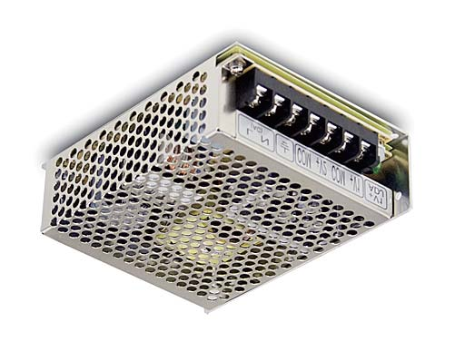
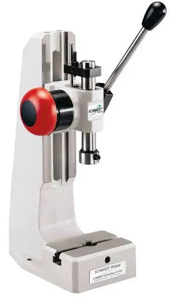
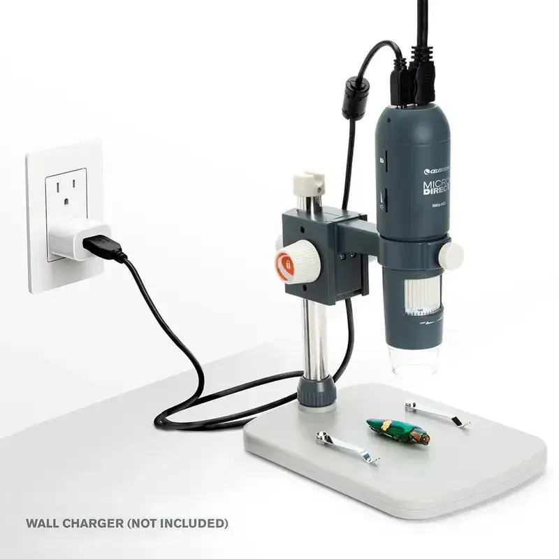
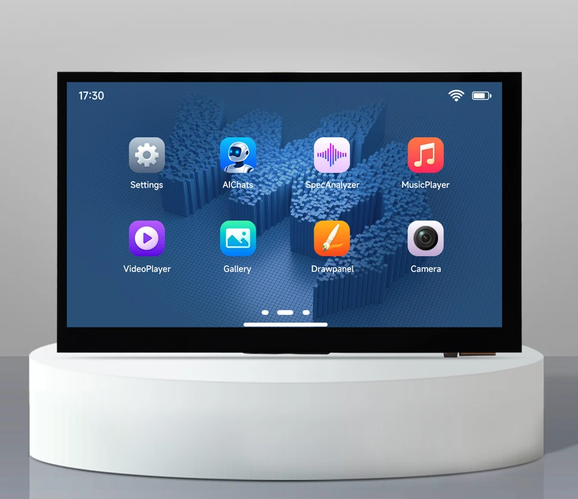

# 3. Materiales

## DigiKey México
| Parte | Descripción | Cant. |
|-------|-------------|-------|
| 1866-3987-ND | Fuente Mean Well RD-65A (5 V 6 A + 12 V 3 A) | 1 |
| 1528-1191-ND | Cerradura solenoide Adafruit 1512 (12 V) | 1 |
| 1738-1077-ND | Relevador DFRobot DFR0017 | 1 |
| 1655-1N4007GCT-ND | Diodo 1N4007 | 2 |
| Nichicon UHE1E102MHD6 | Capacitor 1000 µF / 25 V | 2 |

## Fuera de DigiKey
- Placa Waveshare ESP32-P4-WIFI6-Touch-LCD-7B (SKU 32510; Waveshare o Amazon; puede tardar 30-60 días).
- Extensión USB-A (cable inyector), cable 18/22 AWG, borneras, gabinete ventilado (Steren).

## Equipo ya definido
- Prensa manual Schmidt (piñón y cremallera, palanca).
- Microscopio Celestron MicroDirect 1080p HDMI (44316): por USB es cámara UVC; 5 V / 1 A. USB y HDMI simultáneos: **sin probar**.
- Base original del microscopio (cámara apuntando hacia abajo) con **plantilla/nido de posición** para la pieza (por fabricar).

## Fuente Mean Well RD-65A

*Foto: hoja de datos del fabricante (Mean Well RD-65, versión 2024-11-22).*

| Dato | Valor |
|------|-------|
| Salidas | CH1 5 V / 6 A (ajustable 4.75–5.5 V) · CH2 12 V / 3 A |
| Potencia | 66 W |
| Entrada | 88–264 VAC, 47–63 Hz |
| Rizado máx. | 80 mVp-p (5 V) · 120 mVp-p (12 V) |
| Tolerancia | 5 V ±2 % · 12 V ±6 % |
| Protecciones | Cortocircuito, sobrecarga, sobretensión (CH1); modo hiccup |
| Temperatura | −25 a +70 °C (ver curva de derrateo) |
| Dimensiones / peso | 129 × 98 × 38 mm · 0.44 kg |
| Nota del fabricante | Con varias salidas, se recomienda carga en CH1 > 10 % (≈ 0.6 A) |

Bornes: 1 AC/L · 2 AC/N · 3 FG · 4 y 6 COM · 5 +V2 (12 V) · 7 +V1 (5 V). Ver [conexiones](04-conexiones.md).

## Consumo estimado
5 V ≈ 2.1 A; 12 V ≈ 0.65 A intermitente; total ≈ 19 W de 66 W.
La hoja de datos recomienda CH1 > 10 % de carga (≈ 0.6 A); nuestro 5 V ≈ 2.1 A (≈ 35 %), así que se cumple. Aun así, medir 12 V en reposo; si pasa de 13 V, agregar resistencia 56 Ω / 5 W entre +12 V y COM.

## Equipo (fotos)
| Prensa Schmidt | Microscopio Celestron | Pantalla 7" |
|---|---|---|
|  |  |  |

## Opciones de compra en Amazon México
> Las fichas **no se pudieron leer automáticamente** (Amazon bloqueó el acceso). Las especificaciones de abajo son lo que hay que confirmar en la página antes de comprar; no están verificadas.

| Pieza | Enlace | Confirmar antes de comprar |
|-------|--------|----------------------------|
| Placa ESP32-P4 WiFi6 con pantalla táctil | [B0FTLW5RKN](https://www.amazon.com.mx/dp/B0FTLW5RKN) | Que sea la Waveshare 7B (7", 1024x600), no otro tamaño; USB-A; variante del chip; devoluciones |
| Cerradura solenoide 12 V | [B07H4J3P3P](https://www.amazon.com.mx/dp/B07H4J3P3P) | 12 V y corriente; que quede **bloqueada sin energía**; fuerza y carrera (no soporta ~200 N de la palanca) |
| Fuente Mean Well RD-65A | [B07MH9PNMM](https://www.amazon.com.mx/dp/B07MH9PNMM) | ✅ Confirmado en la ficha: RD-65A, 5 V 6 A + 12 V 3 A, 66 W, **$384.08 MXN**. Falta: vendedor y que sea original (solo 1 reseña) |
| Relé 1 canal con optoacoplador y disparo alto/bajo (tienda YWBL-WH), **$126 MXN** | [B07QLZ6T8W](https://www.amazon.com.mx/dp/B07QLZ6T8W) | ✅ En la foto: relé SRD-5VDC-SL-C (bobina 5 V), contacto 10 A / 30 VDC, bornes NO-COM-NC, puente alto/bajo. **Elegir la variante de 5 V** (el título menciona 5/12/24 V). Falta probar que active con 3.3 V |

Relevador: poner el puente en **alto (H)** para que GPIO alto = relé ON y GPIO bajo o sin señal = bloqueado, y agregar una resistencia de 10 kΩ de IN a GND. Verificar con el osciloscopio o con un LED que el relé no se active al encender o reiniciar la placa.
