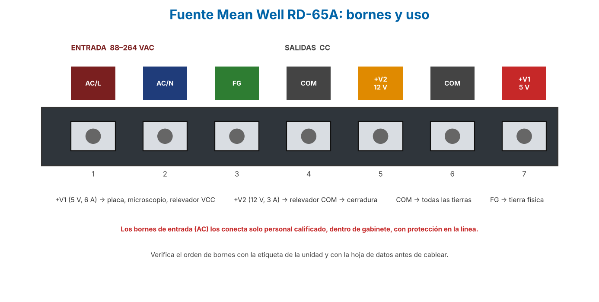
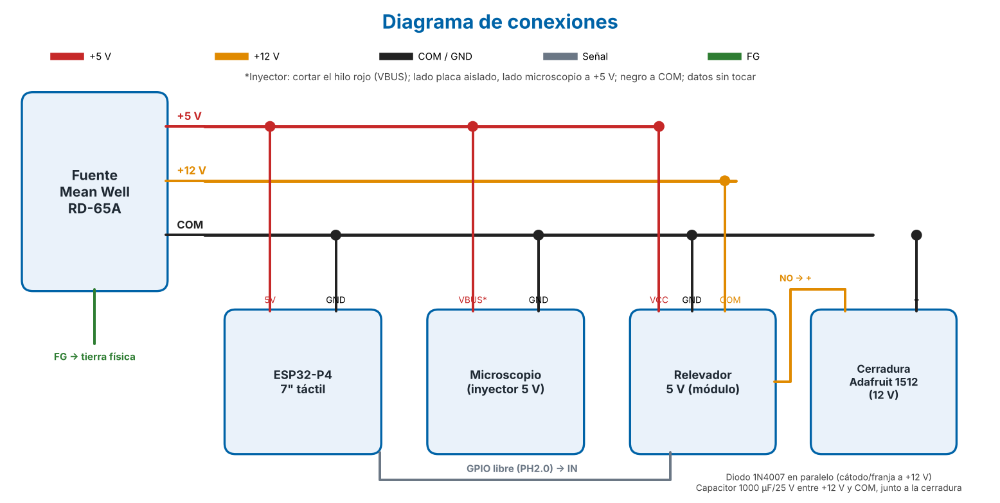
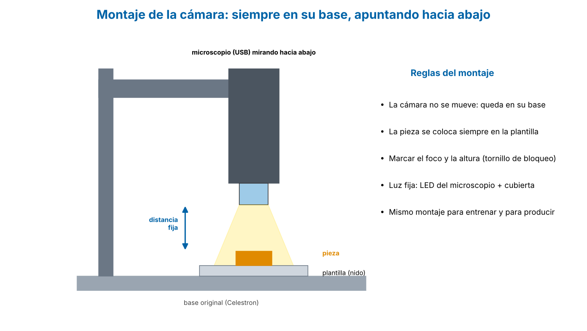

# 4. Guía de conexiones

> Apagar y desconectar de la red eléctrica antes de cablear. Revisar polaridad dos veces.

## Alimentación
| Origen | Destino |
|--------|---------|
| +5 V | Placa (pin 5V), microscopio (inyector), relevador VCC |
| +12 V | Relevador COM |
| Relevador NO | Cerradura + |
| Cerradura − | COM (tierra común) |
| GPIO libre (conector PH2.0) | Relevador IN |
| Todas las tierras | COM |
| FG de la fuente | Tierra física |

## Protección de la cerradura
- Diodo 1N4007 en paralelo con la bobina, **cátodo (franja) hacia +12 V**.
- Capacitor 1000 µF / 25 V entre +12 V y COM, cerca de la cerradura (observar polaridad).

## Cable inyector del microscopio (USB)
1. Usar una extensión USB-A.
2. Cortar el hilo **rojo (VBUS)**.
3. Lado de la placa: aislar el extremo.
4. Lado del microscopio: conectar a +5 V.
5. Negro (GND) unido a COM.
6. Datos (verde/blanco): **sin tocar**.

## Verificaciones antes de energizar
- [ ] Medir +12 V en reposo (si > 13 V, poner 56 Ω / 5 W entre +12 V y COM).
- [ ] Confirmar que el DFR0017 activa con 3.3 V del GPIO.
- [ ] Continuidad: todas las tierras a COM; FG a tierra física.
- [ ] Sin corto entre +5 V, +12 V y COM.

## Fuente: bornes

> La entrada AC (L, N, FG) la conecta solo personal calificado, dentro de gabinete y con protección en la línea.

## Advertencia mecánica
La cerradura Adafruit 1512 es de gabinete y **no soporta los ~200 N de la palanca**. Solo para prueba de concepto con tope rígido; para uso real, consultar a Schmidt y a seguridad e higiene.

## Diagrama de conexiones

## Estaciones y montaje de la cámara

La cámara va siempre en su base, apuntando hacia abajo. El controlador va cerca de la cámara (cable USB corto); la cerradura y el relevador, junto a la prensa (cable de 12 V entre estaciones).
