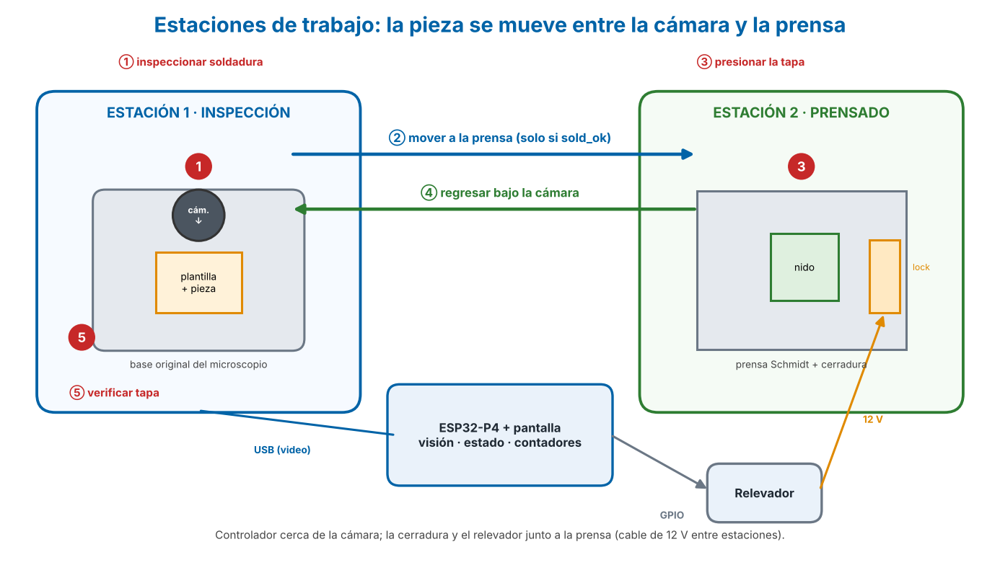
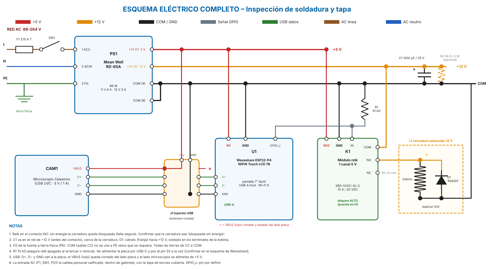
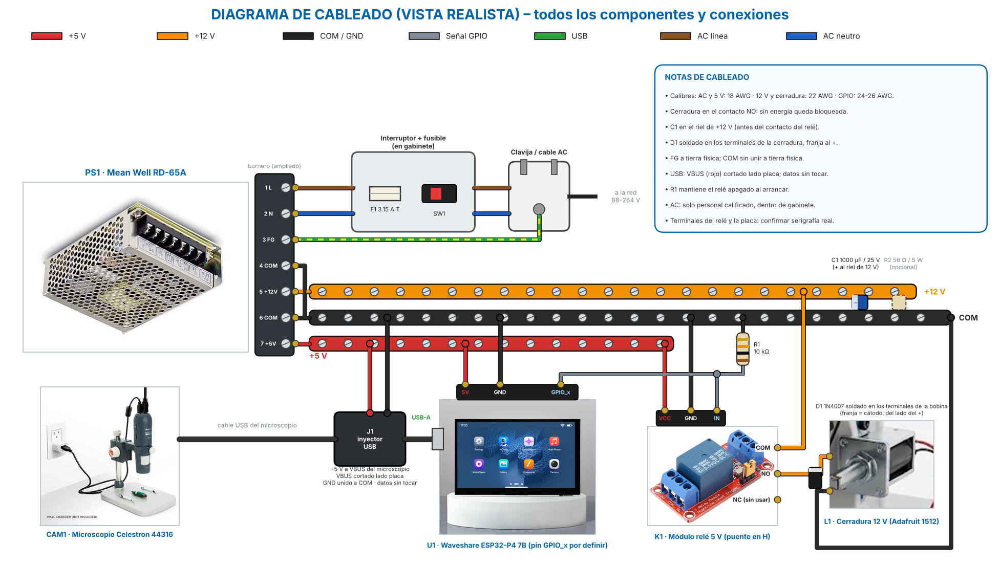

# 4. Guía de conexiones

> Apagar y desconectar de la red eléctrica antes de cablear. Revisar polaridad dos veces.

## Alimentación
| Origen | Destino |
|--------|---------|
| +5 V | Placa (pin 5V), microscopio (inyector), relevador VCC |
| +12 V | Relevador COM |
| Relevador NO | Cerradura + |
| Cerradura − | COM (tierra común) |
| GPIO libre (conector PH2.0) | Relevador IN |
| Todas las tierras | COM |
| FG de la fuente | Tierra física |

## Protección de la cerradura
- Diodo 1N4007 en paralelo con la bobina, **cátodo (franja) hacia +12 V**.
- Capacitor 1000 µF / 25 V entre +12 V y COM, cerca de la cerradura (observar polaridad).

## Cable inyector del microscopio (USB)
1. Usar una extensión USB-A.
2. Cortar el hilo **rojo (VBUS)**.
3. Lado de la placa: aislar el extremo.
4. Lado del microscopio: conectar a +5 V.
5. Negro (GND) unido a COM.
6. Datos (verde/blanco): **sin tocar**.

## Verificaciones antes de energizar
- [ ] Medir +12 V en reposo (si > 13 V, poner 56 Ω / 5 W entre +12 V y COM).
- [ ] Confirmar que el módulo de relé activa con 3.3 V del GPIO.
- [ ] Módulo de Amazon: puente en alto (H), resistencia 10 kΩ de IN a GND, cerradura en el contacto NO.
- [ ] Probar que el relé NO se activa durante el arranque y el reinicio de la placa.
- [ ] Continuidad: todas las tierras a COM; FG a tierra física.
- [ ] Sin corto entre +5 V, +12 V y COM.

## Fuente: bornes

> La entrada AC (L, N, FG) la conecta solo personal calificado, dentro de gabinete y con protección en la línea.

## Advertencia mecánica
La cerradura Adafruit 1512 es de gabinete y **no soporta los ~200 N de la palanca**. Solo para prueba de concepto con tope rígido; para uso real, consultar a Schmidt y a seguridad e higiene.

## Diagrama de conexiones

## Estaciones y montaje de la cámara

La cámara va siempre en su base, apuntando hacia abajo. El controlador va cerca de la cámara (cable USB corto); la cerradura y el relevador, junto a la prensa (cable de 12 V entre estaciones).

## Esquema eléctrico completo

Versión vectorial para imprimir y hacer zoom: [esquema-electrico.pdf](img/esquema-electrico.pdf).

## Diagrama de cableado (vista realista)

Versión vectorial: [cableado-realista.pdf](img/cableado-realista.pdf). La ubicación de los terminales del relé y de la placa es ilustrativa: seguir la serigrafía real de cada módulo.

## Lista de cables
| # | Desde | Hacia | Color | Calibre |
|---|-------|-------|-------|---------|
| 1 | Clavija L | F1 → SW1 → PS1 borne 1 (L) | Café / negro | 18 AWG (tensión de red) |
| 2 | Clavija N | PS1 borne 2 (N) | Azul / blanco | 18 AWG |
| 3 | Clavija tierra | PS1 borne 3 (FG) | Verde-amarillo | 18 AWG |
| 4 | PS1 borne 7 (+V1, 5 V) | Riel +5 V | Rojo | 18 AWG |
| 5 | Riel +5 V | Placa pin 5V | Rojo | 18-22 AWG |
| 6 | Riel +5 V | J1 inyector (VBUS, lado microscopio) | Rojo | 22 AWG |
| 7 | Riel +5 V | K1 VCC | Rojo | 22 AWG |
| 8 | PS1 bornes 4 y 6 (COM) | Riel COM | Negro | 18 AWG |
| 9 | Riel COM | Placa GND | Negro | 22 AWG |
| 10 | Riel COM | J1 inyector (GND) | Negro | 22 AWG |
| 11 | Riel COM | K1 GND | Negro | 22 AWG |
| 12 | Riel COM | L1 − (cerradura) | Negro | 22 AWG |
| 13 | PS1 borne 5 (+V2, 12 V) | Riel +12 V | Naranja | 22 AWG |
| 14 | Riel +12 V | K1 COM (contacto) | Naranja | 22 AWG |
| 15 | K1 NO | L1 + (cerradura) | Naranja | 22 AWG |
| 16 | Placa GPIO_x (por definir) | K1 IN | Gris | 24-26 AWG |
| 17 | K1 IN | R1 10 kΩ → Riel COM | Gris / negro | 24-26 AWG |
| 18 | Microscopio D+, D−, GND | Placa USB-A (vía J1) | Cable USB original | — |

Componentes sueltos: **D1** 1N4007 en los terminales de L1 (franja/cátodo al +); **C1** 1000 µF / 25 V entre riel +12 V y COM (polaridad: + al riel de 12 V); **R2** 56 Ω / 5 W entre +12 V y COM solo si el 12 V en reposo pasa de 13 V; **F1** fusible 3.15 A retardado y **SW1** interruptor en la línea.
